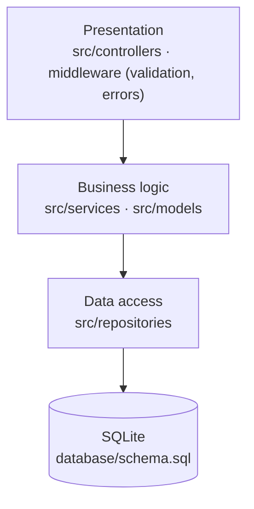

# Task Board — Layered Architecture

**A task-management API refactored from a single-file monolith into clean layers (presentation → business logic → data access), plus a microservices design proposal for a real-time Team Chat feature.**


> **ENGSE207 Software Architecture, Week 4 (team).** Team: นายเบญจศรายุทธ น้อยอุบล, นายชนสรณ์ บุตรถา, นายธาวัน ทิพคุณ, นายอติโรจน์ กุหลั่น.
> First step of a series: **layered** → [N-tier](https://github.com/tawan230666/engse207-task-board) → [load-balanced + Redis](https://github.com/tawan230666/Week6_lab_ntier_redis_loadbalance) → [event-driven](https://github.com/tawan230666/week7_lab_event_driven_rabbitmq) → [secured microservices](https://github.com/tawan230666/engse207-termproject-jwt-microservices).

## Layers



Each layer only talks to the one directly below it:

- **Controllers** translate HTTP requests and responses, and contain no business rules.
- **Services** enforce business rules: high-priority tasks must have a description, and a task marked `DONE` can't go back to `TODO`.
- **Repositories** are the only code that writes SQL.

Validation and error handling are centralised in middleware, so every endpoint returns consistent error responses.

## Run it

```bash
git clone https://github.com/tawan230666/engse207-week4-layered.git
cd engse207-week4-layered
npm install
npm start                 # http://localhost:8080  (npm run dev for auto-reload)
```

The SQLite database is created automatically on first start. The web UI is served from `/`, and `api.http` has ready-made requests for VS Code REST Client.

| Method | Endpoint |
|---|---|
| `GET` | `/api/health` |
| `GET` | `/api/tasks`, `/api/tasks/:id` |
| `POST` | `/api/tasks` |
| `PUT` / `DELETE` | `/api/tasks/:id` |

## Design homework: Team Chat microservices

[`docs/team-chat-design/`](docs/team-chat-design) proposes extending the task board with real-time team chat as microservices:

| Document | Contents |
|---|---|
| `service_design.md` | Service boundaries and responsibilities |
| `architecture_diagram.md` | System architecture |
| `event_flow_diagram.md` | Event flow between services |
| `api_design.yaml` | OpenAPI specification |
| `challenges_solutions.md` | Trade-offs and how to handle them |
